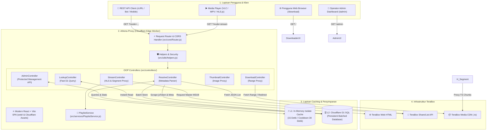
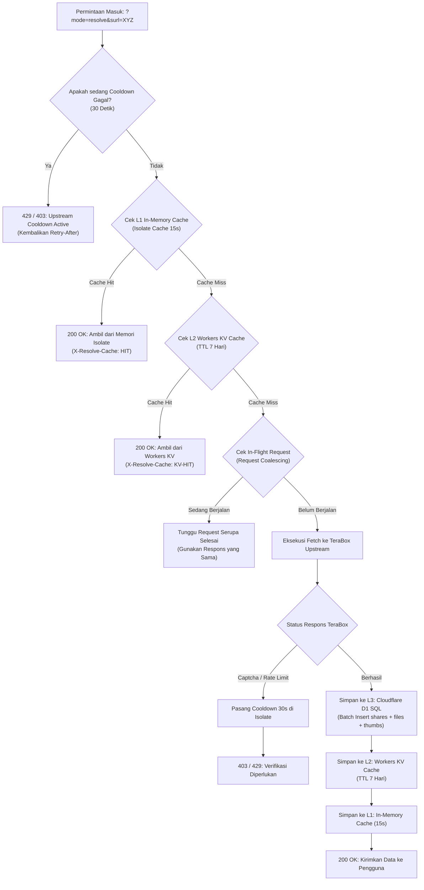
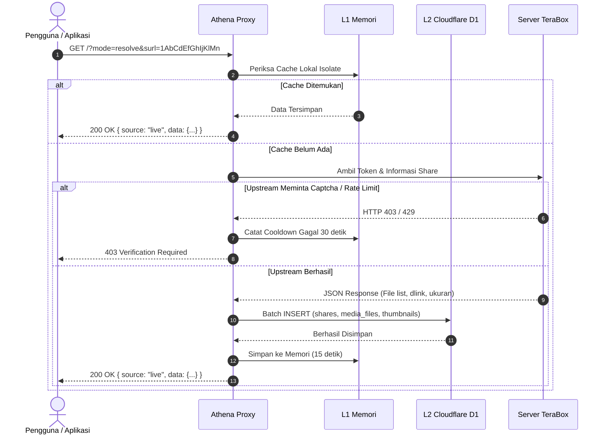
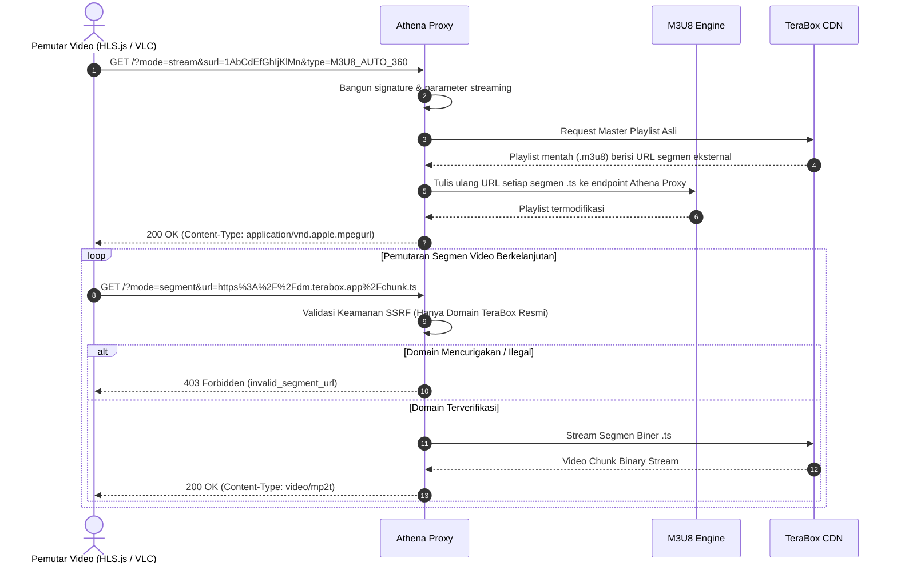
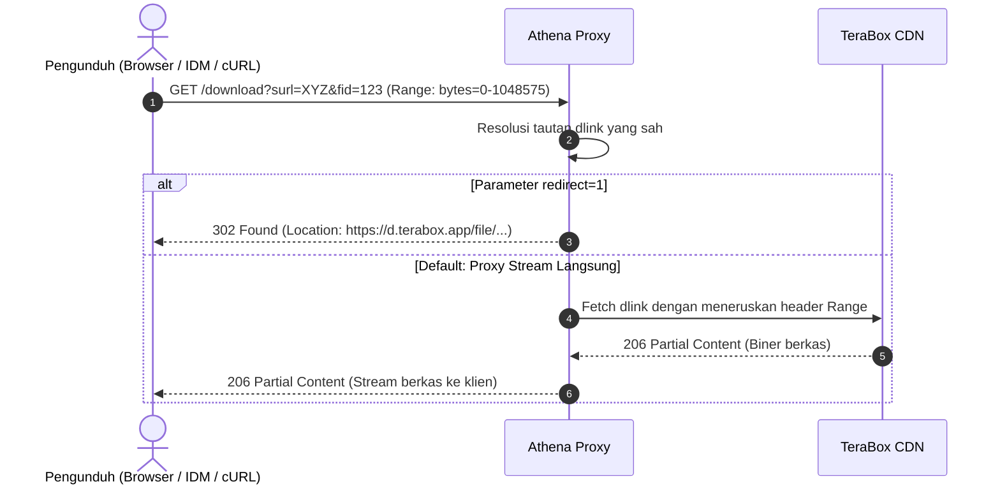
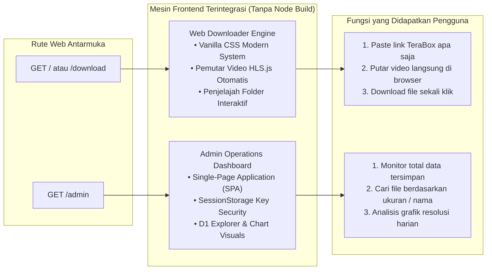

# ⚡ Athena Proxy

<p align="center">
  <strong>High-Performance Serverless Edge Proxy untuk TeraBox File Sharing, HLS Video Streaming, dan Cloudflare D1 Metadata Caching.</strong>
</p>

<p align="center">
  
  
  
  
  
  
</p>

---

## 📖 Daftar Isi

- [📌 Ringkasan Proyek](#-ringkasan-proyek)
- [✨ Fitur Unggulan](#-fitur-unggulan)
- [🏗️ Arsitektur Sistem Terperinci](#️-arsitektur-sistem-terperinci)
  - [1. Arsitektur Berlapis (Multi-Tier Edge Architecture)](#1-arsitektur-berlapis-multi-tier-edge-architecture)
  - [2. Topologi & Diagram Komponen Global](#2-topologi--diagram-komponen-global)
  - [3. Arsitektur Caching Bertingkat (L1 Memory ➔ L2 Workers KV ➔ L3 Cloudflare D1)](#3-arsitektur-caching-bertingkat-l1-memory--l2-workers-kv--l3-cloudflare-d1)
  - [4. Pipeline Resolusi & Metadata (`mode=resolve`)](#4-pipeline-resolusi--metadata-moderesolve)
  - [5. Pipeline Video Streaming HLS (`mode=stream` & `mode=segment`)](#5-pipeline-video-streaming-hls-modestream--modesegment)
  - [6. Pipeline Unduhan Resumable (`mode=download`)](#6-pipeline-unduhan-resumable-modedownload)
  - [7. Arsitektur Antarmuka Web Bawaan (Web Downloader & Admin UI)](#7-arsitektur-antarmuka-web-bawaan-web-downloader--admin-ui)
- [📂 Struktur Proyek & Modul](#-struktur-proyek--modul)
- [🗄️ Skema Database (Cloudflare D1)](#️-skema-database-cloudflare-d1)
- [🌐 Antarmuka Web Bawaan](#-antarmuka-web-bawaan)
  - [Web Downloader (`/` atau `/download`)](#web-downloader--atau-download)
  - [Admin Operations Dashboard (`/admin`)](#admin-operations-dashboard-admin)
- [⚡ Ringkasan Endpoint API](#-ringkasan-endpoint-api)
- [🛠️ Panduan Instalasi & Deployment](#️-panduan-instalasi--deployment)
  - [Prasyarat](#prasyarat)
  - [Langkah Konfigurasi](#langkah-konfigurasi)
  - [Testing Lokal](#testing-lokal)
  - [Deploy ke Cloudflare](#deploy-ke-cloudflare)
- [🔒 Keamanan & SSRF Protection](#-keamanan--ssrf-protection)
- [⚠️ Error Handling & Status Codes](#️-error-handling--status-codes)
- [📄 Lisensi & Disclaimer](#-lisensi--disclaimer)

---

## 📌 Ringkasan Proyek

**Athena Proxy** adalah infrastruktur backend serverless modern yang berjalan di atas jaringan global **Cloudflare Workers**. Layanan ini bertindak sebagai gateway perantara (*intelligent proxy*) untuk tautan publik TeraBox. 

Dengan **Athena Proxy**, pengguna dapat:
- Mengekstrak metadata berkas dan folder secara instan.
- Menonton video secara langsung (*streaming*) melalui protokol adaptif **HLS (HTTP Live Streaming / M3U8)** di pemutar web maupun aplikasi pemutar eksternal (seperti VLC/MPV).
- Mengunduh file langsung dengan dukungan jeda dan lanjut (*resumable download*).
- Menyimpan cache informasi file ke dalam **Cloudflare D1 SQL Database** untuk akses secepat kilat (*sub-25ms latency*).

Layanan ini siap digunakan baik secara visual melalui **Web Downloader UI** terintegrasi, maupun secara programatik melalui **REST API** yang ramah pengembang (*developer-friendly*).

---

## ✨ Fitur Unggulan

- 🚀 **Serverless Edge Performance**: Berjalan di 300+ lokasi pusat data Cloudflare di seluruh dunia dengan latensi mendekati nol.
- 🎬 **HLS Video Streaming (`M3U8`)**: Mengubah link video TeraBox menjadi playlist HLS adaptif yang kompatibel dengan browser, iOS/Android, VLC, dan Smart TV.
- 🛡️ **SSRF-Protected Video Segment Proxy**: Mem-proxy fragmen video (`.ts`) dengan sanitasi ketat menggunakan whitelist domain resmi TeraBox untuk menangkal serangan *Server-Side Request Forgery* (SSRF).
- 💾 **Triple-Tier Intelligent Caching**:
  - **L1 In-Memory Cache (Isolate)**: Menyimpan respons berhasil selama 15 detik per isolate Worker dengan mekanisme *Request Coalescing* (mencegah request ganda serentak).
  - **L2 Cloudflare Workers KV Cache**: Cache berlatensi sub-milidetik (`env.SHARE_KV`) dengan TTL 7 hari untuk pembacaan instan key-value tanpa beban D1/TeraBox.
  - **L3 Cloudflare D1 SQL**: Penyimpanan persisten untuk semua metadata share, berkas media, dan thumbnail.
- ⚡ **Direct & Resumable Download Stream**: Endpoint download dengan dukungan header `Range` (HTTP 206 Partial Content) dan mode redirect CDN `302`.
- 🖥️ **Web Downloader UI Auto-Responsive**: Antarmuka bersih, ramah pengguna awam, dilengkapi video player bawaan, penjelajah hierarki folder, dan sinkronisasi instan (*Sync DB*).
- 📊 **Admin Operations Dashboard Terproteksi & Diskrit**: Panel 6-tab monitoring terproteksi key (Overview, Kelola Share, Arsip Berkas, Galeri Thumbnail, Cache KV, Diagnostik Edge) dengan shortcut rahasia (5-tap logo atau `Ctrl+Shift+A`), auto-clearing URL key, dan tombol gembok pengunci instan.
- 🌐 **Full CORS & Standard JSON**: Siap dihubungkan ke bot Telegram/Discord, aplikasi mobile, maupun web frontend apa pun.

---

## 🏗️ Arsitektur Sistem Terperinci

### 1. Arsitektur Berlapis (Multi-Tier Edge Architecture)

Athena Proxy dibangun dengan arsitektur berlapis yang memisahkan tanggung jawab antara antarmuka, keamanan, perutean, logika streaming, dan penyimpanan:

```
┌─────────────────────────────────────────────────────────────────────────────┐
│ 1. CLIENT TIER                                                              │
│    Web Browser / Downloader UI │ Media Player (VLC/MPV) │ Bot / Mobile Apps │
└──────────────────────────────────────┬──────────────────────────────────────┘
                                       │ HTTPS / HTTP GET Requests
┌──────────────────────────────────────▼──────────────────────────────────────┐
│ 2. EDGE GATEWAY & ROUTING TIER (Cloudflare Worker Core)                     │
│    CORS Headers Handler │ Route Dispatcher │ Parameter Parser               │
└───────────────────┬─────────────────────────────────────┬───────────────────┘
                    │                                     │
┌───────────────────▼─────────────────────┐  ┌────────────▼───────────────────┐
│ 3. SECURITY & PROTECTION TIER           │  │ 4. BUILT-IN UI ENGINE          │
│    • SSRF Domain Whitelist Guard        │  │    • Web Downloader (HLS UI)   │
│    • Circuit Breaker (30s Cooldown)     │  │    • Admin Operations (SPA)    │
│    • Admin Token Authenticator          │  └────────────────────────────────┘
└───────────────────┬─────────────────────┘
                    │ Validated Request
┌───────────────────▼─────────────────────────────────────────────────────────┐
│ 5. PROCESSING & BUSINESS LOGIC TIER                                         │
│    • Resolve Engine (HTML Parser & Token Extractor)                         │
│    • HLS Stream Engine & M3U8 Rewriter                                      │
│    • Direct Binary & Segment Streaming Proxy                                │
└───────────────────┬─────────────────────────────────────┬───────────────────┘
                    │                                     │
┌───────────────────▼─────────────────────┐  ┌────────────▼───────────────────┐
│ 6. CACHING & STORAGE TIER               │  │ 7. UPSTREAM PROVIDER TIER      │
│    • L1: Isolate In-Memory Cache (15s)  │  │    • TeraBox HTML Web Pages    │
│    • L2: Cloudflare D1 SQL (Persistent) │  │    • TeraBox Share & File APIs │
│          [shares, media_files, thumbs]  │  │    • TeraBox CDN Video Segments│
└─────────────────────────────────────────┘  └────────────────────────────────┘
```

---

### 2. Topologi & Diagram Komponen Global

Diagram interaksi antar komponen dalam ekosistem Athena Proxy:



---

### 3. Arsitektur Caching Bertingkat (L1 Memory ➔ L2 Workers KV ➔ L3 Cloudflare D1)

Untuk menjamin kecepatan tinggi dan meminimalisir kemungkinan pemblokiran dari server TeraBox, Athena Proxy menerapkan strategi caching bertingkat:



---

### 4. Pipeline Resolusi & Metadata (`mode=resolve`)



---

### 5. Pipeline Video Streaming HLS (`mode=stream` & `mode=segment`)



---

### 6. Pipeline Unduhan Resumable (`mode=download`)



---

### 7. Arsitektur Antarmuka Web Bawaan (Web Downloader & Admin UI)



---

## 📂 Struktur Proyek & Modul

Berikut struktur modul kode sumber Athena Proxy:

```
athena-proxy/
├── src/
│   ├── core/                           # Inti arsitektur aplikasi & routing OOP
│   │   ├── Application.js              # Kelas Application utama untuk Cloudflare Worker
│   │   ├── Router.js                   # Kelas Router untuk route & query dispatcher
│   │   └── HttpResponse.js             # Kelas HttpResponse builder (CORS, error formatting)
│   ├── controllers/                    # Controller penangan rute & request
│   │   ├── BaseController.js           # Base controller dengan helper repositori & respon
│   │   ├── ResolveController.js        # Controller mode=resolve & metadata extraction
│   │   ├── StreamController.js         # Controller mode=stream & mode=segment HLS
│   │   ├── DownloadController.js       # Controller mode=download & resumable stream
│   │   ├── ThumbnailController.js      # Controller mode=thumbnail & dynamic refresh
│   │   ├── LookupController.js         # Controller mode=lookup langsung dari D1
│   │   ├── AdminController.js          # Controller REST API operations dashboard
│   │   └── LegacyController.js         # Controller mode=page & mode=api
│   ├── services/                       # Logika bisnis dan integrasi eksternal
│   │   ├── TeraBoxService.js           # Client interaksi API & scraping TeraBox
│   │   ├── HttpClient.js               # HTTP client dengan timeout & retry otomatis
│   │   ├── CookieService.js            # Pengelola cookie sesi & domain matching
│   │   ├── CacheService.js             # In-memory L1 cache & failure cooldown
│   │   ├── PlaylistService.js          # Parser & rewriter playlist M3U8
│   │   └── TransformerService.js       # Transformasi data berkas & proxy thumbnail
│   ├── repositories/                   # Lapisan persistensi data (Data Access Layer)
│   │   └── ShareRepository.js          # Abstraksi Cloudflare D1 SQL (batch & queries)
│   ├── config/                         # Konfigurasi & konstanta sistem
│   │   └── constants.js                # Allowlist domain, TTL cache, signing keys
│   ├── utils/                          # Fungsi pembantu & sanitasi
│   │   └── helpers.js                  # Validator SURL, token extraction, math helpers
│   └── index.js                        # Worker entrypoint (mendelegasikan ke Application & Router)
├── web/                                # Modern React + Vite + Tailwind frontend
│   ├── src/
│   │   ├── components/                 # Reusable UI components (Navbar, VideoPlayer, FileCard, FolderView)
│   │   ├── pages/                      # DownloaderPage.jsx & AdminPage.jsx
│   │   ├── services/api.js             # Client API terpusat
│   │   ├── App.jsx                     # Route switcher SPA
│   │   ├── main.jsx                    # React root entrypoint
│   │   └── index.css                   # Tailwind CSS & theme tokens
│   ├── dist/                           # Production build bundle untuk Cloudflare Workers Assets
│   ├── index.html                      # HTML root template
│   ├── vite.config.js                  # Vite configuration
│   └── package.json                    # Dependencies React & Tailwind
├── scripts/
│   ├── verify-baseline.js              # Unit & integration test kesesuaian sistem
│   └── wrangler-dev-local-cookie.cjs   # Runner dev lokal dengan injeksi cookie otomatis
├── schema.sql                          # Skema SQL D1 (shares, media_files, thumbnails)
├── wrangler.toml                       # Konfigurasi Cloudflare Workers, Assets, & binding D1
├── README.md                           # Dokumentasi arsitektur dan teknis proyek
└── USAGE.md                            # Panduan praktis penggunaan API & Web
```

### Penjelasan Modul & Layer OOP

| Lapisan / Modul | Berkas Utama | Tanggung Jawab Utama |
|---|---|---|
| **Core Architecture** | [`src/core/`](file:///home/athenaserver/Project/Web/tbx-proxy/src/core/) | Mengelola daur hidup request Worker, pipeline middleware CORS, dan routing permintaan secara berorientasi objek. |
| **Controllers** | [`src/controllers/`](file:///home/athenaserver/Project/Web/tbx-proxy/src/controllers/) | Memisahkan setiap mode endpoint ke dalam controller khusus (`Resolve`, `Stream`, `Download`, `Thumbnail`, `Lookup`, `Admin`, `Legacy`). |
| **Domain Services** | [`src/services/`](file:///home/athenaserver/Project/Web/tbx-proxy/src/services/) | Enkapsulasi logika bisnis: klien upstream TeraBox, HTTP fetch dengan exponential backoff, manajemen sesi cookie, cache memori L1, dan manipulasi M3U8. |
| **Data Repository** | [`src/repositories/`](file:///home/athenaserver/Project/Web/tbx-proxy/src/repositories/) | Abstraksi akses database D1 (SQLite terdistribusi) untuk menyimpan dan mengambil share, media files, dan thumbnails dalam batch. |
| **Config & Helpers** | [`src/config/`](file:///home/athenaserver/Project/Web/tbx-proxy/src/config/), [`src/utils/`](file:///home/athenaserver/Project/Web/tbx-proxy/src/utils/) | Konstanta allowlist, waktu TTL cache, dan fungsi sanitasi parameter URL/SURL. |
| **Modern Frontend SPA** | [`web/`](file:///home/athenaserver/Project/Web/tbx-proxy/web/) | Antarmuka pengguna modern berbasis React 18, Vite, Tailwind CSS, Lucide icons, dan HLS.js, di-serve melalui Cloudflare Workers Static Assets. |

---

## 🗄️ Skema Database (Cloudflare D1)

Data file dan share disimpan dalam Cloudflare D1 (SQLite terdistribusi) menggunakan skema berikut:

```sql
-- Tabel ringkasan share TeraBox
CREATE TABLE IF NOT EXISTS shares (
  share_id TEXT PRIMARY KEY,
  uk TEXT,
  shareid TEXT,
  title TEXT,
  server_time INTEGER,
  cfrom_id TEXT,
  errno INTEGER,
  request_id TEXT,
  updated_at DATETIME
);

-- Tabel rincian setiap berkas/media di dalam share
CREATE TABLE IF NOT EXISTS media_files (
  fs_id TEXT PRIMARY KEY,
  share_id TEXT,
  category TEXT,
  isdir INTEGER,
  local_ctime INTEGER,
  local_mtime INTEGER,
  md5 TEXT,
  path TEXT,
  play_forbid INTEGER,
  server_ctime INTEGER,
  server_filename TEXT,
  server_mtime INTEGER,
  size INTEGER,
  is_adult INTEGER,
  cmd5 TEXT,
  dlink TEXT
);

-- Tabel daftar URL thumbnail untuk preview gambar/video
CREATE TABLE IF NOT EXISTS thumbnails (
  id INTEGER PRIMARY KEY AUTOINCREMENT,
  fs_id TEXT,
  url TEXT,
  thumbnail_type TEXT
);

-- Indeks performa query pencarian
CREATE INDEX IF NOT EXISTS idx_media_files_share_id ON media_files(share_id);
CREATE INDEX IF NOT EXISTS idx_thumbnails_fs_id ON thumbnails(fs_id);
```

---

## 🌐 Antarmuka Web Bawaan

### Web Downloader (`/` atau `/download`)
- Akses langsung melalui browser: `https://webdl.athenax.workers.dev/`
- **Fitur**:
  - Kolom input praktis untuk URL TeraBox maupun shortcode (`surl`).
  - Tombol **Paste** otomatis dari clipboard.
  - Video Player HLS bawaan: tonton video langsung di browser tanpa install aplikasi tambahan.
  - Tampilan hierarki folder dan penjelajah file interaktif.
  - Tombol **Sync DB** untuk sinkronisasi ulang data langsung dari TeraBox ke Database D1.
  - Tombol download langsung ke perangkat.
  - Desain 100% **Auto-Responsive** (nyaman di HP 320px–375px hingga monitor Desktop ultra-wide).

### Admin Operations Dashboard (`/admin`)
- Akses melalui: `https://webdl.athenax.workers.dev/admin`
- **Fitur Keamanan & Privasi (*Zero Admin Leaks*)**:
  - Secara default konsol tersembunyi dari publik dan navbar publik hanya menampilkan status gateway.
  - Akses rahasia: Tekan logo ⚡ Athena sebanyak 5 kali beruntun ATAU tekan shortcut `Ctrl + Shift + A` (`Alt + A`).
  - Input Security Key (`ADMIN_KEY`) tersimpan aman di `localStorage` dan parameter `?key=` otomatis dihapus dari URL browser history.
  - Tombol **Kunci Console** (gembok merah) untuk keluar dan menyembunyikan konsol seketika.
- **6 Tab Operasional Terpadu**:
  1. **Ringkasan (Overview)**: KPI total share, berkas media, thumbnail, kapasitas storage, breakdown kategori, dan aktivitas share terbaru dengan format tanggal lokal Indonesia yang akurat.
  2. **Kelola Share**: Pencarian instan judul/SURL/UK, pagination dinamis, sorting, modal rincian berkas, dan hapus data.
  3. **Arsip Berkas Media**: Filter kategori (Video, Gambar, Berkas, Folder), filter rentang ukuran, dan pemutar preview video/gambar langsung.
  4. **Galeri Thumbnail**: Visual grid thumbnail media dengan filter fs_id.
  5. **Cache & KV**: Monitor status Workers KV, inspeksi raw JSON cache, dan fitur **Purge KV** instan.
  6. **Diagnostik & Edge**: Pengujian latency riil sub-25ms ke edge endpoint Cloudflare Workers dan pemeriksaan status probe D1.

---

## ⚡ Ringkasan Endpoint API

Semua endpoint berbasis **HTTP GET** (dan **POST/DELETE** untuk manajemen admin) dengan dukungan penuh header CORS.

| Mode / Path | Kegunaan | Parameter Utama | Output |
|---|---|---|---|
| `GET /` atau `/download` | Web Downloader UI | Tidak ada | HTML Page |
| `GET /?mode=resolve` | Ekstrak metadata & simpan ke D1/KV | `surl` *(wajib)*, `refresh=1`, `raw=1` | JSON `{ source, data }` |
| `GET /?mode=stream` | Dapatkan playlist streaming M3U8 | `surl` *(wajib)*, `type`, `fid` | M3U8 Playlist Stream |
| `GET /download` atau `?mode=download` | Download stream berkas langsung | `surl`, `fid` *(wajib)*, `redirect=1`, `json=1` | Binary File / 302 Redirect / JSON |
| `GET /?mode=lookup` | Query instan data D1 (tanpa upstream) | `surl` atau `fid` *(wajib)* | JSON `{ source: "d1", data }` |
| `GET /?mode=segment` | Proxy fragmen TS video (SSRF safe) | `url` *(wajib, domain TeraBox)* | Binary `.ts` video stream |
| `GET /?mode=thumbnail` | Proxy thumbnail ter-cache | `url` *(wajib)* | Binary Image Stream |
| `GET /?mode=health` | Pemeriksaan kesehatan layanan | Tidak ada | JSON `{ status: "ok" }` |
| `GET /admin/overview` | Ringkasan statistik & KPI D1 | Header `x-admin-key` atau `?key=` | JSON `{ counts, latestShares, kv }` |
| `GET /admin/shares` | Data tabel share (search, sort, page) | `page`, `pageSize`, `q`, `sort`, `order` | JSON `{ items, total, page }` |
| `GET /admin/files` | Data arsip media files (kategori, ukuran) | `category`, `size_min`, `size_max`, `q` | JSON `{ items, total, page }` |
| `GET /admin/kv/stats` | Statistik cache Workers KV & TTL policy | Header `x-admin-key` | JSON `{ enabled, ttl_seconds }` |
| `GET /admin/kv/lookup` | Inspeksi raw cache KV berdasarkan SURL | `surl` *(wajib)* | JSON `{ surl, cached, data }` |
| `POST /admin/kv/purge` | Bersihkan cache KV untuk SURL tertentu | `surl` *(opsional)* | JSON `{ ok, purged }` |
| `DELETE /admin/shares/:id` | Hapus share dan berkas terkait di D1 | `:id` (share_id) | JSON `{ ok, deleted_files }` |

> [!TIP]
> Panduan lengkap penggunaan API, contoh kode cURL, Fetch JavaScript, Python, dan panduan untuk orang awam tersedia di [**USAGE.md**](file:///home/athenaserver/Project/Web/tbx-proxy/USAGE.md).

---

## 🛠️ Panduan Instalasi & Deployment

### Prasyarat
1. Node.js versi 18 atau lebih baru.
2. Akun [Cloudflare](https://dash.cloudflare.com/) dengan fitur Workers & D1 aktif.
3. [Cloudflare Wrangler CLI](https://developers.cloudflare.com/workers/wrangler/) terpasang (`npm install -g wrangler`).

### Langkah Konfigurasi

1. **Clone Repository & Masuk ke Direktori:**
   ```bash
   git clone <repo-url>
   cd athena-proxy
   ```

2. **Buat Database Cloudflare D1:**
   ```bash
   npx wrangler d1 create sharedfile
   ```
   *Catat `database_id` yang dihasilkan oleh terminal.*

3. **Perbarui `wrangler.toml`:**
   Sesuaikan `database_id` dan `ADMIN_KEY` Anda di [`wrangler.toml`](file:///home/athenaserver/Project/Web/tbx-proxy/wrangler.toml):
   ```toml
   name = "dl"
   main = "src/index.js"
   compatibility_date = "2024-09-23"

   [[d1_databases]]
   binding = "sharedfile"
   database_name = "sharedfile"
   database_id = "MASUKKAN_DATABASE_ID_ANDA"

   [vars]
   ADMIN_KEY = "kunci_rahasia_admin_anda"
   ```

4. **Inisialisasi Tabel Database:**
   Eksekusi skema SQL lokal atau remote:
   ```bash
   # Inisialisasi ke D1 Cloudflare Production:
   npx wrangler d1 execute sharedfile --remote --file=./schema.sql

   # Atau untuk pengetesan lokal:
   npx wrangler d1 execute sharedfile --local --file=./schema.sql
   ```

### Testing Lokal & Pengembangan Frontend

1. **Jalankan Frontend React (Vite HMR):**
   ```bash
   npm run dev:web
   ```
   Aplikasi React + TailwindCSS akan berjalan di `http://localhost:5173` dengan Hot Module Replacement (HMR).

2. **Jalankan Backend Worker Secara Lokal:**
   ```bash
   npm run dev
   # Atau dengan cookie lokal:
   npm run dev:cookie
   ```
   Server backend Worker akan aktif di `http://localhost:8787` (atau `8788`).

3. **Build Frontend Production:**
   ```bash
   npm run build:web
   ```
   Aset statis dikompilasi ke direktori `./web/dist` dan siap di-serve oleh Cloudflare Workers Static Assets.

### Deploy ke Cloudflare

Kompilasi frontend dan deploy ke jaringan global Cloudflare Workers dengan satu perintah:
```bash
npm run deploy
```
*Perintah ini otomatis mengompilasi `./web/dist` dan mempublikasikannya bersama Worker ke Cloudflare CDN.*

Worker Anda akan langsung aktif di domain Anda, misalnya: `https://webdl.athenax.workers.dev/`.

---

## 🔒 Keamanan & SSRF Protection

1. **Whitelist Domain Segmen (Anti-SSRF)**:
   Pada `mode=segment`, Worker hanya mengizinkan pengunduhan dari domain TeraBox resmi:
   - `terabox.com`, `terabox.app`
   - `1024tera.com`, `1024terabox.com`, `freeterabox.com`
   - `teraboxcdn.com`, `dm.terabox.app`, `dm.1024tera.com`
   - `terasharelink.com`, `terafileshare.com`, `terasharefile.com`
   - Percobaan memasukkan IP lokal (misalnya `127.0.0.1` atau `169.254.169.254`) akan otomatis ditolak dengan kode `403 Forbidden`.

2. **Isolasi Kredensial**:
   Session cookie pengunjung browser **tidak pernah** diteruskan secara terbuka ke server hulu. Kunci admin (`ADMIN_KEY`) dilindungi di sisi server Worker environment variables.

3. **Perlindungan Cooldown & Rate Limit**:
   Worker menerapkan cooldown 30 detik untuk permintaan gagal atau terindikasi verifikasi captcha, guna mencegah pemblokiran IP oleh server upstream.

---

## ⚠️ Error Handling & Status Codes

Semua respons error disajikan dalam format JSON standar:

```json
{
  "error": "Pesan deskripsi kesalahan yang mudah dibaca",
  "code": "error_code_string",
  "details": "Detail teknis tambahan (jika ada)",
  "required": ["parameter_yang_kurang"]
}
```

| HTTP Status | Error Code (`code`) | Arti & Cara Mengatasi |
|---|---|---|
| `400` | `bad_request` / `invalid_mode` | Parameter wajib (`surl`, `fid`, dsb.) tidak diisi atau salah format. |
| `401` | `unauthorized` | Kunci admin (`x-admin-key`) salah atau belum disertakan pada rute `/admin/*`. |
| `403` | `invalid_segment_url` | URL video segmen ditolak oleh filter SSRF karena bukan domain resmi TeraBox. |
| `403` | `upstream_verification_required` | TeraBox meminta verifikasi Captcha. Buka link asli di browser untuk menyelesaikan tantangan. |
| `404` | `not_found` | File, share ID, atau entri database tidak ditemukan. |
| `429` | `upstream_rate_limited` / `upstream_backoff` | Terlalu banyak permintaan ke TeraBox. Perhatikan header `Retry-After`. |
| `502` | `upstream_error` / `incomplete_stream_metadata` | Server TeraBox memberikan respons kosong atau playlist m3u8 gagal diproses. |
| `503` | `d1_unavailable` | Binding database D1 di `wrangler.toml` belum dikonfigurasi dengan benar. |
| `504` | `upstream_timeout` | Permintaan ke server upstream TeraBox melebihi batas waktu (timeout). |

---

## 📄 Lisensi & Disclaimer

- **Lisensi**: Proyek ini dilisensikan di bawah lisensi terbuka [MIT](LICENSE).
- **Disclaimer**: Proyek ini dibuat murni untuk tujuan edukasi dan interoperabilitas data. Pengguna bertanggung jawab penuh atas konten yang diakses melalui layanan ini. Layanan ini tidak berafiliasi dengan TeraBox maupun Flextech Inc.
