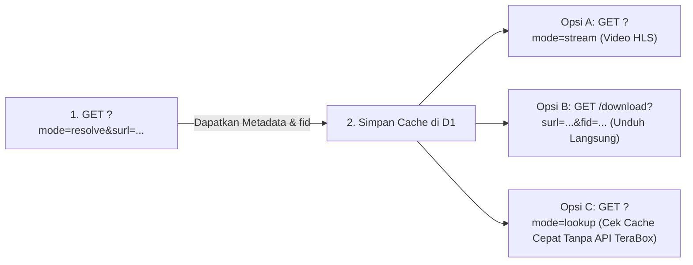

# 🚀 Panduan Penggunaan Lengkap Athena Proxy

<p align="center">
  <strong>Panduan Praktis, Ramah Pemula, dan Lengkap untuk Menikmati Layanan Streaming & Unduh TeraBox</strong>
</p>

<p align="center">
  
  
  
  
</p>

---

## 📌 Alamat Utama Layanan (Base URL)

Gunakan tautan resmi berikut untuk mengakses semua fitur layanan:

```text
https://dl.athenax.workers.dev/
```

---

## 📑 Daftar Isi

- [🟢 BAGIAN 1: Panduan Singkat untuk Orang Awam (Tanpa Koding)](#-bagian-1-panduan-singkat-untuk-orang-awam-tanpa-koding)
  - [1.1 Apa itu Athena Proxy?](#11-apa-itu-athena-proxy)
  - [1.2 Cara Mudah Mendapatkan & Memasukkan Link](#12-cara-mudah-mendapatkan--memasukkan-link)
  - [1.3 Langkah Menggunakan Web Downloader](#13-langkah-menggunakan-web-downloader)
  - [1.4 Cara Menonton di Pemutar Media Luar (VLC / MPV)](#14-cara-menonton-di-pemutar-media-luar-vlc--mpv)
  - [1.5 Tanya Jawab yang Sering Ditanyakan (FAQ Pemula)](#15-tanya-jawab-yang-sering-ditanyakan-faq-pemula)
- [🔵 BAGIAN 2: Panduan Lengkap untuk Developer & Integrasi API](#-bagian-2-panduan-lengkap-untuk-developer--integrasi-api)
  - [2.1 Ringkasan Alur Pemanggilan API](#21-ringkasan-alur-pemanggilan-api)
  - [2.2 Daftar Lengkap Mode API](#22-daftar-lengkap-mode-api)
  - [2.3 Rincian Setiap Mode & Contoh cURL](#23-rincian-setiap-mode--contoh-curl)
  - [2.4 Contoh Implementasi Kode Nyata (JavaScript & Python)](#24-contoh-implementasi-kode-nyata-javascript--python)
- [🟣 BAGIAN 3: Panel Admin & Monitoring Database](#-bagian-3-panel-admin--monitoring-database)
- [🔴 BAGIAN 4: Kamus Error & Solusi Praktis](#-bagian-4-kamus-error--solusi-praktis)

---

## 🟢 BAGIAN 1: Panduan Singkat untuk Orang Awam (Tanpa Koding)

> [!NOTE]
> Anda tidak perlu paham pemrograman untuk menggunakan layanan ini! Cukup gunakan browser di HP atau laptop Anda.

### 1.1 Apa itu Athena Proxy?

Pernahkah Anda menerima link video atau file dari **TeraBox**, namun repot saat membukanya karena harus download aplikasi, login, atau banyak iklan yang mengganggu?

**Athena Proxy** bertindak sebagai *"jembatan cerdas"*. Layanan ini langsung mengekstrak isi link TeraBox Anda agar:
1. **Bisa ditonton langsung** di browser layaknya menonton di YouTube.
2. **Bisa diunduh langsung** dengan sekali klik tanpa aplikasi pihak ketiga.
3. **Bisa menjelajahi isi folder** jika link tersebut berisi banyak file.

---

### 1.2 Cara Mudah Mendapatkan & Memasukkan Link

Layanan ini mendukung berbagai format tautan resmi TeraBox:

| Contoh Tautan yang Didukung | Keterangan |
|---|---|
| `https://terabox.app/s/1AbCdEfGhIjKlMn` | Link lengkap terabox.app |
| `https://1024tera.com/s/1AbCdEfGhIjKlMn` | Link mirror 1024tera |
| `https://terasharelink.com/s/1AbCdEfGhIjKlMn` | Link domain alternatif |
| `1AbCdEfGhIjKlMn` | Kode unik pendeknya saja (*Short URL / Surl*) |

> [!TIP]
> **Cara mengambil kode `surl` manual:**  
> Jika link Anda adalah `https://terabox.app/s/1XyZ12345`, maka kodenya adalah `1XyZ12345` (karakter setelah `/s/`).

---

### 1.3 Langkah Menggunakan Web Downloader

Ikuti 3 langkah mudah berikut:

```
[1. Buka Website] ➔ [2. Tempel Link TeraBox] ➔ [3. Tonton / Unduh File]
```

1. **Buka Web Downloader:**  
   Buka browser (Chrome, Edge, Safari, Firefox di HP/PC), lalu kunjungi:  
   👉 **[https://dl.athenax.workers.dev/](https://dl.athenax.workers.dev/)**
2. **Tempel Tautan:**  
   Salin link TeraBox yang Anda punya, lalu klik tombol **Paste** atau tempelkan di kotak input URL.
3. **Tekan Tombol Periksa (Resolve):**  
   Klik tombol hitam bertanda panah `->`. Layanan akan memeriksa file selama 1-2 detik.
4. **Nikmati Konten:**
   - **Jika berupa Video**: Pemutar video bawaan akan langsung muncul. Anda bisa langsung memutar video, mengatur kualitas, atau fullscreen.
   - **Jika berupa Folder**: Anda akan melihat daftar file di dalamnya. Klik nama sub-folder untuk membukanya.
   - **Download Berkas**: Klik tombol **Download** di samping nama file untuk langsung mengunduh ke memori perangkat Anda.

---

### 1.4 Cara Menonton di Pemutar Media Luar (VLC / MPV)

Jika Anda ingin memutar video dengan subtitle atau di Smart TV menggunakan **VLC Media Player**:

1. Dapatkan kode link TeraBox Anda (misal `1AbCdEfGhIjKlMn`).
2. Buat URL streaming seperti ini:
   ```text
   https://dl.athenax.workers.dev/?mode=stream&surl=1AbCdEfGhIjKlMn
   ```
3. Buka aplikasi **VLC Media Player**:
   - Di PC/Laptop: Pilih menu **Media** ➔ **Open Network Stream** (atau tekan `Ctrl + N`).
   - Di Android/iOS: Buka tab **More / Network** ➔ **Open Network Stream**.
4. Tempel URL di atas, lalu tekan **Play**. Video akan langsung terputar tanpa jeda iklan!

---

### 1.5 Tanya Jawab yang Sering Ditanyakan (FAQ Pemula)

#### ❓ Tanya: "Kenapa videonya hanya berdurasi 30 detik atau cuma preview?"
> **Jawab:** TeraBox membatasi pemutaran publik untuk beberapa video tertentu hanya sebagai cuplikan (*30-second preview*). Untuk mengunduh video versi lengkap, gunakan tombol **Download** langsung atau buka tautan aslinya.

#### ❓ Tanya: "Muncul tulisan merah 'Verification Required' (Perlu Verifikasi), kenapa?"
> **Jawab:** TeraBox secara berkala memunculkan tes Captcha anti-bot pada tautan tertentu. Jika ini terjadi, klik tautan *"Buka di TeraBox"* yang muncul di layar, selesaikan Captcha di browser Anda satu kali, lalu coba lagi.

#### ❓ Tanya: "Apakah data saya aman saat memakai web ini?"
> **Jawab:** Sangat aman! Layanan ini tidak menyimpan password Anda, tidak meminta pendaftaran akun, dan tidak menyimpan berkas pribadi Anda di server.

---

## 🔵 BAGIAN 2: Panduan Lengkap untuk Developer & Integrasi API

Bagi developer web, bot Telegram, maupun aplikasi mobile, Athena Proxy menyediakan RESTful API berlatensi sangat rendah di jaringan edge Cloudflare.

### 2.1 Ringkasan Alur Pemanggilan API



---

### 2.2 Daftar Lengkap Mode API

Semua request menggunakan metode **`HTTP GET`**:

| Mode / Rute | Deskripsi Singkat | Parameter Wajib | Parameter Opsional |
|---|---|---|---|
| `resolve` ⭐ | Ekstrak metadata, daftar file, & auto-cache ke D1 | `surl` | `refresh`, `raw`, `dir`, `fid` |
| `stream` 🎬 | Menghasilkan playlist streaming HLS (`.m3u8`) | `surl` | `type`, `fid`, `dir` |
| `download` ⚡ | Unduh file binary atau dapatkan link redirect | `surl`, `fid` | `redirect`, `json` |
| `lookup` 🚀 | Query kilat langsung ke database D1 (tanpa hit TeraBox) | `surl` atau `fid` | - |
| `segment` 🛡️ | Proxy fragmen file video `.ts` (SSRF Protected) | `url` | - |
| `thumbnail` 🖼️ | Proxy dan fallback gambar thumbnail | `url` | `fid`, `surl` |
| `page` 📄 | Ambil HTML mentah dari halaman share TeraBox | `surl` | - |
| `api` ⚙️ | Panggilan manual ke API internal TeraBox | `shorturl`, `jsToken` | `dir` |
| `health` 💓 | Status kesehatan dan timestamp server | - | - |

---

### 2.3 Rincian Setiap Mode & Contoh cURL

#### 1. Mode `resolve` (Ekstraksi Metadata Utama)
Digunakan untuk mengekstrak informasi detail berkas seperti ukuran, nama file, ID sistem file (`fid`), dan URL download. Hasilnya otomatis disimpan ke database D1.

```bash
curl -X GET "https://dl.athenax.workers.dev/?mode=resolve&surl=1AbCdEfGhIjKlMn"
```

**Contoh Output Respons JSON:**
```json
{
  "source": "live",
  "data": {
    "name": "Tutorial_Video_HD.mp4",
    "size": 314572800,
    "time": 1718000000,
    "fid": "511133506523791",
    "shareid": "10524102871",
    "uk": "4401146149342",
    "thumb": "https://data.teraboxcdn.com/thumbnail/...",
    "dlink": "https://d.terabox.app/file/...",
    "stored_at": 1718000005,
    "last_verified": 1718000005
  }
}
```

**Parameter Tambahan:**
- `refresh=1` : Memaksa mengambil data baru dan mengabaikan in-memory cache sementara.
- `raw=1` : Mengembalikan seluruh data respons asli mentah dari TeraBox API di properti `"upstream"`.
- `dir=/nama_folder` : Menjelajahi sub-folder tertentu.

---

#### 2. Mode `stream` (Streaming HLS Video M3U8)
Mengembalikan playlist standar `.m3u8`. URL setiap segmen video di dalamnya telah ditransformasikan secara otomatis agar diarahkan melalui proxy aman Worker.

```bash
curl -X GET "https://dl.athenax.workers.dev/?mode=stream&surl=1AbCdEfGhIjKlMn"
```

**Parameter Tambahan:**
- `type` : Kualitas video (Pilihan: `M3U8_AUTO_360`, `M3U8_AUTO_720`, `M3U8_FLV_264_360`). Default disesuaikan dengan browser pengunjung.
- `fid` : ID file spesifik jika tautan share berisi lebih dari 1 file video.

**Hasil Respons:**
```text
#EXTM3U
#EXT-X-VERSION:3
#EXT-X-TARGETDURATION:6
#EXTINF:6.000,
https://dl.athenax.workers.dev/?mode=segment&url=https%3A%2F%2Fdm.terabox.app%2F...
#EXT-X-ENDLIST
```

---

#### 3. Mode `download` (Pengunduhan Berkas)
Endpoint ini digunakan untuk mengunduh berkas dengan dukungan *Resumable Download* (`Range` header).

Tersedia dalam 3 variasi:

##### A. Download Stream Langsung (Rekomendasi untuk cURL/IDM):
```bash
curl -L -O "https://dl.athenax.workers.dev/download?surl=1AbCdEfGhIjKlMn&fid=511133506523791"
```

##### B. Dapatkan 302 Redirect ke Link CDN Asli:
```bash
curl -i "https://dl.athenax.workers.dev/download?surl=1AbCdEfGhIjKlMn&fid=511133506523791&redirect=1"
```

##### C. Dapatkan Link JSON untuk Aplikasi Anda:
```bash
curl -X GET "https://dl.athenax.workers.dev/download?surl=1AbCdEfGhIjKlMn&fid=511133506523791&json=1"
```
*Respons:*
```json
{
  "ok": true,
  "filename": "Tutorial_Video_HD.mp4",
  "size": 314572800,
  "dlink": "https://d.terabox.app/file/signed_download_link..."
}
```

---

#### 4. Mode `lookup` (Pencarian Kilat Database D1)
Mode tercepat (kurang dari 25ms). Mengambil data yang sebelumnya sudah pernah di-resolve dari D1 Database tanpa menghubungi server TeraBox sama sekali.

```bash
# Lookup berdasarkan surl (share ID):
curl -X GET "https://dl.athenax.workers.dev/?mode=lookup&surl=1AbCdEfGhIjKlMn"

# Atau lookup berdasarkan fid (File ID):
curl -X GET "https://dl.athenax.workers.dev/?mode=lookup&fid=511133506523791"
```

---

#### 5. Mode `health` (Pengecekan Status Layanan)
```bash
curl -X GET "https://dl.athenax.workers.dev/?mode=health"
```
*Respons:*
```json
{
  "status": "ok",
  "timestamp": "2026-10-11T19:30:00.000Z"
}
```

---

### 2.4 Contoh Implementasi Kode Nyata (JavaScript & Python)

#### Contoh 1: JavaScript (Web Browser / Node.js)
Memasang pemutar video HLS streaming di website Anda menggunakan [HLS.js](https://github.com/video-dev/hls.js):

```html
<!DOCTYPE html>
<html>
<head>
  <script src="https://cdn.jsdelivr.net/npm/hls.js@latest"></script>
</head>
<body>
  <video id="my-video" controls width="720" style="background:#000; border-radius:8px;"></video>

  <script>
    const surl = '1AbCdEfGhIjKlMn';
    const streamUrl = `https://dl.athenax.workers.dev/?mode=stream&surl=${surl}`;
    const video = document.getElementById('my-video');

    if (Hls.isSupported()) {
      const hls = new Hls();
      hls.loadSource(streamUrl);
      hls.attachMedia(video);
      hls.on(Hls.Events.MANIFEST_PARSED, () => video.play());
    } else if (video.canPlayType('application/vnd.apple.mpegurl')) {
      // Untuk browser dengan dukungan bawaan (Safari / iOS)
      video.src = streamUrl;
      video.play();
    }
  </script>
</body>
</html>
```

#### Contoh 2: Python (Ekstrak Metadata & Download)
```python
import requests

BASE_URL = "https://dl.athenax.workers.dev"
SURL = "1AbCdEfGhIjKlMn"

# 1. Resolve metadata
print("Sedang mengambil informasi file...")
resolve_res = requests.get(f"{BASE_URL}/?mode=resolve&surl={SURL}").json()

if "data" in resolve_res:
    file_info = resolve_res["data"]
    filename = file_info["name"]
    fid = file_info["fid"]
    print(f"File ditemukan: {filename} ({round(file_info['size'] / (1024*1024), 2)} MB)")

    # 2. Dapatkan link download
    dl_res = requests.get(f"{BASE_URL}/download?surl={SURL}&fid={fid}&json=1").json()
    if dl_res.get("ok"):
        print(f"URL Download Siap: {dl_res['dlink']}")
else:
    print("Gagal mengambil file:", resolve_res.get("error"))
```

---

## 🟣 BAGIAN 3: Panel Admin & Monitoring Database

Athena Proxy dilengkapi antarmuka admin terpadu untuk mengecek log share dan metrik operasional:

- **Halaman Admin**: Buka `https://dl.athenax.workers.dev/admin` di browser Anda.
- **Autentikasi**: Masukkan password kunci admin (`ADMIN_KEY`) yang telah Anda set di `wrangler.toml`. Kunci disimpan secara aman di browser session Anda.

### Endpoint REST API Admin
Jika ingin membaca data admin secara programatik, kirimkan header `x-admin-key: KUNCI_ANDA` atau parameter `?key=KUNCI_ANDA`:

```bash
# 1. Ringkasan jumlah share & file
curl -H "x-admin-key: KUNCI_ANDA" "https://dl.athenax.workers.dev/admin/overview"

# 2. Daftar share tersimpan (dengan pencarian & pagination)
curl -H "x-admin-key: KUNCI_ANDA" "https://dl.athenax.workers.dev/admin/shares?page=1&pageSize=20&q=video"

# 3. Daftar seluruh file media
curl -H "x-admin-key: KUNCI_ANDA" "https://dl.athenax.workers.dev/admin/files?size_min=1048576"

# 4. Grafik riwayat jumlah share per hari
curl -H "x-admin-key: KUNCI_ANDA" "https://dl.athenax.workers.dev/admin/analytics/processed?limit=30"
```

---

## 🔴 BAGIAN 4: Kamus Error & Solusi Praktis

Jika Anda mendapati pesan error dari API, temukan kode error pada tabel di bawah ini untuk melihat solusinya:

| HTTP Status | Error Code | Arti Masalah | Solusi Praktis |
|:---:|---|---|---|
| **400** | `bad_request` | Parameter wajib (`surl`, `fid`, dll.) belum diisi. | Periksa apakah URL atau parameter query sudah lengkap. |
| **400** | `invalid_mode` | Mode yang diminta tidak dikenali. | Gunakan mode valid: `resolve`, `stream`, `download`, `lookup`, dll. |
| **401** | `unauthorized` | Kunci admin salah atau belum diisi. | Pastikan header `x-admin-key` sesuai dengan `ADMIN_KEY`. |
| **403** | `upstream_verification_required` | TeraBox mewajibkan verifikasi Captcha. | Buka link share di browser biasa, selesaikan Captcha, lalu coba kembali. |
| **403** | `invalid_segment_url` | Keamanan SSRF menolak URL segmen di luar domain resmi TeraBox. | Pastikan URL segmen berasal dari domain CDN resmi TeraBox. |
| **404** | `not_found` | File atau share ID tidak ditemukan. | Link mungkin sudah dihapus oleh pemiliknya atau sudah kedaluwarsa. |
| **429** | `upstream_rate_limited` | Terlalu banyak permintaan dalam waktu singkat. | Tunggu beberapa detik sesuai nilai header `Retry-After`. |
| **502** | `upstream_error` / `incomplete_stream_metadata` | Server TeraBox sedang gangguan atau tidak membalas. | Coba ulangi beberapa saat lagi atau tambahkan parameter `refresh=1`. |
| **503** | `d1_unavailable` | Database D1 Worker belum terhubung. | Periksa binding `sharedfile` pada konfigurasi `wrangler.toml`. |
| **504** | `upstream_timeout` | Jaringan ke TeraBox mengalami time out. | Ulangi request beberapa saat lagi. |

---

<p align="center">
  Dibuat dengan ❤️ untuk kemudahan akses dan performa tinggi di atas <strong>Cloudflare Workers Edge Network</strong>.
</p>
